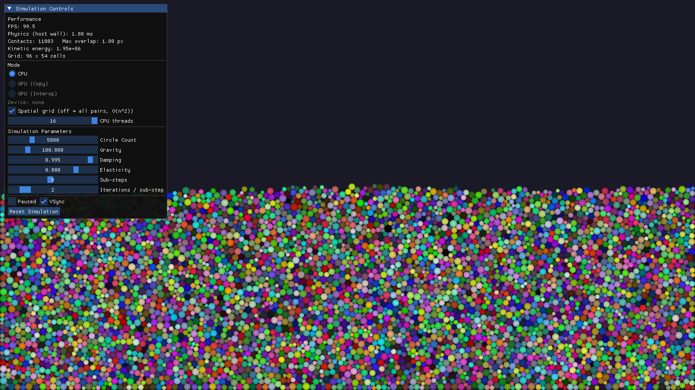

# GPU Circle Collision Simulation

A real-time 2D circle physics simulator with matching CPU and CUDA solvers. Both run the same algorithm (a uniform-grid broad phase and a Jacobi-style contact solver with sub-stepping), so the modes can be compared directly, and the GPU path renders through CUDA-OpenGL interop without copying results back to the host.



*CPU mode with 5,000 circles on 16 threads (1.8 ms of physics per frame). This capture came from a machine without a CUDA GPU, which is why the GPU modes are greyed out.*

## Features

- **Three modes**, switchable at runtime without losing state:
  - **CPU**: OpenMP-parallel solver, with a toggle between the spatial grid and an all-pairs O(n²) reference.
  - **GPU (Copy)**: CUDA solver; render data is copied to pinned host memory and uploaded to OpenGL.
  - **GPU (Interop)**: CUDA writes render data straight into the OpenGL vertex buffer, so nothing round-trips over PCIe.
- **Up to 20,000 circles.** Radii scale with the count so the circles fit in the box.
- **Stable stacking.** Sub-stepping plus Jacobi iterations, a fixed 120 Hz timestep, and sleeping of near-stationary bodies.
- **Live metrics**: frame rate, host physics time, GPU time from CUDA events, contact count, maximum overlap, and kinetic energy.
- **Headless benchmark** (`circle_bench`) and a **physics test suite** (`ctest`). Neither needs a window or a GPU.

## How it works

### Data layout: structure of arrays

Each circle attribute is its own contiguous array: positions and velocities as `float2`, then radius, inverse mass and colour. A warp reading `pos[i]` for 32 consecutive circles touches one contiguous 256-byte span, so the loads coalesce. With the old array-of-structs layout, every load pulled whole 36-byte structs. On the CPU the arrays are 64-byte aligned, so no two arrays share a cache line.

### Broad phase: spatial hashing with a sorted uniform grid

The cell size is the largest circle diameter, so every overlapping pair lies in the same or an adjacent cell. Each sub-step on the GPU runs four stages:

1. `k_integrate_hash`, one thread per circle: integrate, then compute the circle's cell id.
2. `cub::DeviceRadixSort::SortPairs` sorts (cell, index) pairs. It sorts only the bits the largest cell id needs, which means fewer radix passes.
3. `k_reorder` finds each cell's `[start, end)` range. Each thread compares its key with its neighbour's, with the keys staged in **shared memory** so each is read from global memory once. It then gathers every attribute into cell order.
4. After the gather, circles in the same cell are adjacent in memory, so each solver thread's neighbour reads hit nearby addresses and the cache.

The CPU builds the same grid with a counting sort. This replaces the old O(n²) all-pairs test.

### Narrow phase: one thread per circle, no atomics

Each thread owns one circle. It scans the 3×3 neighbouring cells and accumulates the position correction and velocity impulse it receives from each contact, then writes **only its own state** to a separate output buffer (Jacobi iteration with double buffering). Because nothing writes to a neighbour, no atomics are needed, there's no write contention, and on the CPU there's no false sharing. The results are also bitwise identical for any CPU thread count, which the tests check.

The old version launched one thread per *pair*: O(n²) threads, a binary search per thread to decode the pair index, and `atomicAdd` on both bodies' positions.

Jacobi propagates support through a tall stack more slowly than sequential Gauss-Seidel. **Sub-stepping** compensates (Macklin et al., *Small Steps in Physics Simulation*, 2019). Splitting a step into short sub-steps with few iterations each converges much faster than one long step with many iterations. On a 20,000-circle pile at the same total cost, 16 sub-steps × 1 iteration gives a median overlap of 3.5% of the radius, against 30% for 1 × 16 (measured with the CPU solver, which shares the GPU's math in `src/contact.h`).

### Other GPU optimisations

- **CUDA Graphs.** A frame is about 10 kernel launches per sub-step. It's captured once into a graph and replayed, re-captured only when a parameter changes, which removes most of the per-launch CPU overhead.
- **Warp-shuffle reductions** for the statistics: shuffles within a warp, then one shared-memory slot per warp, then one atomic per block instead of one per thread.
- **Vectorised stores.** Render data is one 16-byte `float4` per circle (x, y, radius, packed RGBA8): a single coalesced store per thread, in exactly the layout the VBO expects.
- **`const __restrict__` pointers** and `__launch_bounds__(256)`, which let the compiler use the read-only data path and budget registers. All kernels use 39 registers or fewer with zero spills (`ptxas -v`, sm_86), which allows 100% theoretical occupancy at 256 threads per block.
- **No host stalls for metrics.** Timing uses CUDA events, and statistics are copied into double-buffered pinned memory and read back one frame later without blocking.
- **Pinned host memory** for the copy-mode transfer, and all device buffers (including CUB's scratch space) allocated once at start-up.

### Rendering

Circles are drawn as instanced quads (4 vertices instead of the old 32-vertex triangle fan). The fragment shader computes an anti-aliased disc, so edges are smooth at any radius. The CPU and copy modes stream into an orphaned buffer; interop mode draws from a separate buffer registered with CUDA, which is never re-specified because that would invalidate the registration.

## Benchmarks

`circle_bench [count] [steps]` times one 1/120 s step (8 sub-steps × 2 iterations) on a settled pile. Measured on an AMD Ryzen 7 7800X3D (8 cores / 16 threads):

| Solver | 5,000 circles | 20,000 circles |
|---|---|---|
| CPU, all pairs O(n²), 1 thread | 349.1 ms | – |
| CPU, uniform grid, 1 thread | 12.6 ms | 53.6 ms |
| CPU, uniform grid, 16 threads (OpenMP) | 1.30 ms | 5.80 ms |
| GPU | run `circle_bench` on a CUDA machine | |

The grid is **27.8× faster** than all pairs at 5,000 circles, and OpenMP gives a **9.7× speedup** on 16 threads. `circle_bench` prints the GPU row and the GPU-vs-CPU speedups automatically when a CUDA device is present.

## Requirements

- C/C++17 compiler and CMake 3.18+
- OpenGL 3.3, plus the usual X11 development packages on Linux
- **Optional:** CUDA Toolkit 12.0+ and an NVIDIA GPU (compute capability 7.5+ by default). Without CUDA the project builds in CPU-only mode.
- **Optional:** OpenMP (the CPU solver is single-threaded without it)
- Python 3 (used by the setup script to generate the GLAD loader)

CUDA-OpenGL interop is not supported under WSL2. There the app detects this and uses GPU (Copy) mode.

## Building

```bash
./setup_dependencies.sh            # clones GLFW + ImGui and generates GLAD into external/
cmake -S . -B build -DCMAKE_BUILD_TYPE=Release
cmake --build build -j
./build/circle_sim
```

Other targets:

```bash
./build/circle_bench 20000 200     # headless timings (CPU, OpenMP, and GPU if available)
ctest --test-dir build             # physics tests (no window or GPU needed)
```

To target a specific GPU, pass e.g. `-DCMAKE_CUDA_ARCHITECTURES=86`. To build only the solver, tests and benchmark without any graphics dependencies, pass `-DCIRCLE_SIM_BUILD_APP=OFF`.

## Project structure

```
src/
├── contact.h            # per-body solver math shared by CPU and GPU (host/device inline)
├── circle.h             # SoA data layout, CPU and GPU solver APIs
├── physics_cpu.c        # CPU solver: counting-sort grid, OpenMP Jacobi iterations
├── physics_gpu.cu       # CUDA solver: radix-sort grid, reorder, solve kernels, graphs, interop
├── physics_gpu_stub.cpp # used when building without CUDA
├── renderer.cpp/h       # instanced quad rendering with anti-aliased discs
├── ui.cpp/h             # ImGui controls and metrics
├── main.cpp             # window, fixed-timestep loop, mode switching
└── benchmark.cpp        # headless benchmark
tests/
└── test_physics_cpu.c   # grid vs brute force, thread determinism, stacking stability
```

## Tests

`test_physics_cpu` checks that:

- the grid finds exactly the same contacts, with the same result, as the all-pairs reference;
- results are bitwise identical with 1 thread and with all threads;
- piles of 500, 5,000 and 20,000 circles settle (finite, in bounds, bounded overlap, kinetic energy under 5% of the initial value);
- two circles with identical centres are pushed apart.

## Controls

The left panel switches modes and changes the circle count, gravity, damping, elasticity, sub-steps and iterations. It also toggles the CPU grid, sets the thread count, and pauses, resets or toggles vsync. `ESC` quits.

## Known limitations and next steps

- No friction or rotation: circles are smooth discs.
- The grid is rebuilt every sub-step. Rebuilding less often with a slightly larger cell (a Verlet-list style margin) would cut sort cost.
- The GPU kernels have been compiled and checked with `ptxas`, and the shared algorithm is covered by the CPU tests. GPU timings depend on the hardware, so run `circle_bench` to measure them.
- Mouse interaction (dragging circles, applying forces) is not implemented yet.

## License

This project is open source and available under the MIT License.
