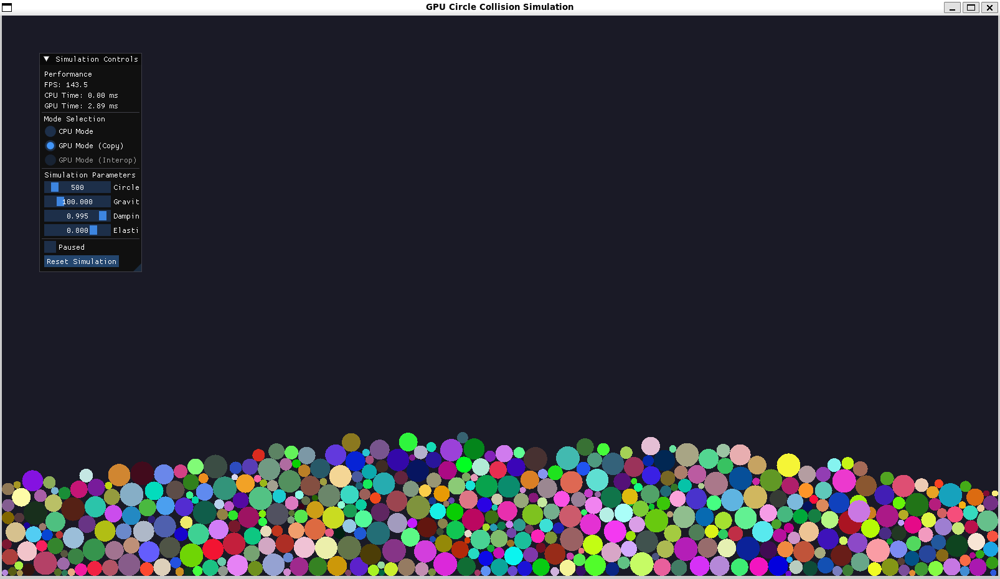

# GPU Circle Collision Simulation

A high-performance 2D circle collision physics simulator leveraging CUDA for GPU acceleration. This project demonstrates the power of parallel computing by simulating thousands of circles with realistic collision detection, gravity, and boundary interactions in real-time.



## Features

- **Three Computation Modes:**
  - **CPU Mode**: Traditional single-threaded physics computation
  - **GPU Mode (Copy)**: CUDA-accelerated physics with data transfer via cudaMemcpy
  - **GPU Mode (Interop)**: CUDA-OpenGL interoperability for zero-copy rendering (when available)

- **Realistic Physics:**
  - Circle-to-circle collision detection and response
  - Boundary collision handling with elasticity
  - Gravity simulation
  - Velocity damping
  - Mass-based dynamics
  - Iterative constraint solver for stable stacking

- **Interactive Controls:**
  - Adjustable simulation parameters (gravity, damping, elasticity)
  - Dynamic circle count (10-5000 circles)
  - Real-time mode switching
  - Pause/resume functionality
  - Performance metrics display

- **Optimized Rendering:**
  - Instanced rendering for efficient GPU utilization
  - Smooth 60+ FPS with thousands of circles
  - Colorful visualization with per-circle random colors

## Demo

The simulation handles up to 5000 circles simultaneously with realistic physics interactions:

<p align="center">
  
</p>

The screenshot shows 500 circles settling under gravity, demonstrating stable stacking behavior and collision resolution. The UI panel displays real-time performance metrics and control options.

## Requirements

### System Requirements
- **NVIDIA GPU** with CUDA support (Compute Capability 7.5 or higher recommended)
- CUDA Toolkit 11.0 or higher
- OpenGL 3.3 or higher
- C++17 compatible compiler
- CMake 3.18 or higher

### Dependencies
- **GLFW** 3.3.8 - Window and input handling
- **GLAD** - OpenGL function loader
- **ImGui** 1.89.9 - User interface
- **CUDA Toolkit** - GPU computation

## Building from Source

### 1. Clone the Repository

```bash
git clone https://github.com/yourusername/gpu-circle-simulation.git
cd gpu-circle-simulation
```

### 2. Setup Dependencies

Run the dependency setup script to download GLFW and ImGui:

```bash
chmod +x setup_dependencies.sh
./setup_dependencies.sh
```

**Note:** GLAD requires manual download:
1. Visit [glad.dav1d.de](https://glad.dav1d.de/)
2. Configure with these settings:
   - Language: **C/C++**
   - Specification: **OpenGL**
   - API gl: **Version 3.3+**
   - Profile: **Core**
   - Generate a loader: **YES**
3. Download and extract to `external/glad/`

The directory structure should be:
```
external/glad/
├── include/
│   ├── glad/
│   │   └── glad.h
│   └── KHR/
│       └── khrplatform.h
└── src/
    └── glad.c
```

### 3. Install CUDA Toolkit

**Ubuntu/Debian:**
```bash
wget https://developer.download.nvidia.com/compute/cuda/repos/ubuntu2204/x86_64/cuda-keyring_1.0-1_all.deb
sudo dpkg -i cuda-keyring_1.0-1_all.deb
sudo apt-get update
sudo apt-get install cuda-toolkit-12-0
```

**Other platforms:** Follow the [official CUDA installation guide](https://docs.nvidia.com/cuda/cuda-installation-guide-linux/).

### 4. Build the Project

```bash
mkdir build
cd build
cmake ..
make -j$(nproc)
```

### 5. Run the Simulation

```bash
./circle_sim
```

## Project Structure

```
gpu-circle-simulation/
├── src/
│   ├── main.cpp              # Main application loop
│   ├── physics_cpu.c         # CPU physics implementation
│   ├── physics_gpu.cu        # CUDA GPU physics kernels
│   ├── renderer.cpp/h        # OpenGL rendering
│   ├── ui.cpp/h              # ImGui interface
│   └── circle.h              # Data structures and API
├── shaders/
│   ├── circle.vert           # Vertex shader
│   └── circle.frag           # Fragment shader
├── external/                 # Third-party dependencies
├── images/                   # Demo images
├── CMakeLists.txt           # Build configuration
├── setup_dependencies.sh    # Dependency setup script
└── README.md                # This file
```

## Usage

### Controls

**UI Panel (left side):**
- **Mode Selection**: Choose between CPU, GPU (Copy), or GPU (Interop) modes
- **Circle Count**: Adjust number of simulated circles (10-5000)
- **Gravity**: Control gravitational acceleration (0-500)
- **Damping**: Adjust velocity damping (0.9-1.0)
- **Elasticity**: Set collision bounciness (0.1-1.0)
- **Paused**: Pause/resume simulation
- **Reset Simulation**: Reinitialize with new random positions

**Keyboard:**
- `ESC`: Exit application

### Performance Tips

- **For maximum performance**: Use GPU Mode (Interop) if available
- **For stability testing**: Use CPU Mode with fewer circles
- **GPU Mode (Copy)** provides a middle ground with good performance and compatibility
- Reduce circle count if frame rate drops below 30 FPS
- Lower damping values create more energetic simulations but may be less stable

## Technical Details

### Physics Implementation

The simulation uses an iterative constraint-based solver with:
- **Collision Detection**: Efficient O(n²) broad-phase with spatial coherence
- **Collision Response**: Impulse-based resolution with Baumgarte stabilization
- **Constraint Iterations**: 10-20 iterations depending on circle count for stable stacking
- **Position Correction**: Mass-weighted projection to resolve penetrations
- **Resting Contact**: Velocity threshold for sleeping low-motion circles

### GPU Acceleration

**CUDA Kernels:**
- `update_positions`: Parallel integration of velocities
- `detect_resolve_collisions`: Parallel collision detection and response
- `handle_boundaries`: Parallel boundary constraint enforcement

**Optimization Techniques:**
- Coalesced memory access patterns
- Shared memory for collision pairs
- Thread block optimization for occupancy
- Optional CUDA-OpenGL interop for zero-copy rendering

### Rendering

- **Instanced rendering**: Single draw call for all circles
- **Vertex shader**: Per-instance transformations
- **Fragment shader**: Solid color rendering
- **Orthographic projection**: 2D screen-space coordinates

## Known Limitations

- CUDA-OpenGL interop may not be available on all systems (falls back to GPU Copy mode)
- Very high circle counts (>3000) may cause frame rate drops on older GPUs
- macOS support is limited due to CUDA unavailability (CPU mode only)
- Collision detection is O(n²) and not spatially partitioned

## Future Improvements

- [ ] Spatial partitioning (grid or quadtree) for better collision performance
- [ ] Additional physics features (friction, angular velocity)
- [ ] Interactive mouse interaction (drag circles, add forces)
- [ ] Parallel collision detection with atomic operations
- [ ] Compute shader alternative for broader GPU compatibility
- [ ] Recording and playback functionality

## License

This project is open source and available under the MIT License.

## Acknowledgments

- **GLFW** - Window management
- **ImGui** - Immediate mode GUI
- **GLAD** - OpenGL loader
- **NVIDIA CUDA** - GPU computing platform

## Contributing

Contributions are welcome! Please feel free to submit a Pull Request.

## Contact

For questions or suggestions, please open an issue on GitHub.

---

**Enjoy simulating thousands of bouncing circles! 🔵🟢🔴**